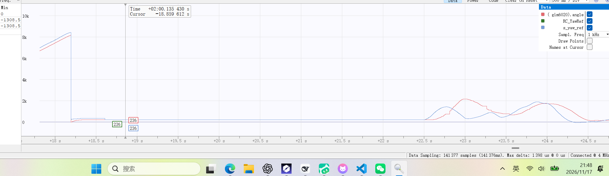
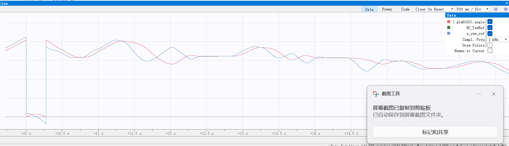
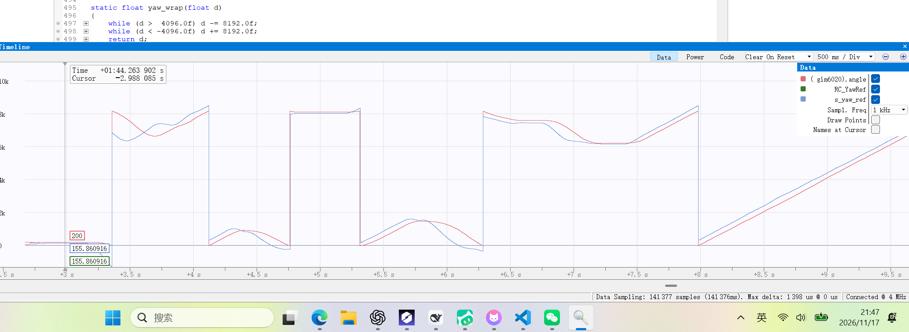
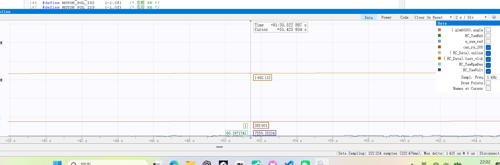

# 遥控“失联”/ yaw 无响应 排查记录

- 日期：2026-11-17 21:52 ~ 23:14
- 工程：`C:\Users\elaina\Desktop\STM32.HAL.exercise\Remote_Control`
- 固件：HEAD `7a3a2b5`，`text 43896`（小陀螺＝世界目标→关节目标 + 关节位置环）
- 参与：用户 / 助手

---

## 21:52 用户

> 现在现象基本符合，但是仍有问题，遥控失联率达到90%左右，yaw或者说其他所有电机的遥控都很卡，以直观的yaw来说，遥控yaw的时候yaw电机不转，此时无法遥控整车，短时间后整车好像有游戏延迟一样执行运动，就是感觉很卡，有时候yaw不动的时候pitch仍可以遥控，这是我截取的一部分波形，其中直线部分为遥控不了的时间段





---

## 21:54 助手

先说波形怎么读，再说怎么查。

**波形里那两段"死掉"是什么**

平直段 = 遥控离线时的 fail-safe（`remote/rc_dbus.c:523-527`）：`online==0` 时把 `s_yaw_ref` 冻在当前角度、输出 0，所以 `s_yaw_ref`/`RC_YawRef` 双双躺平。

另外那些**垂直跳变不是故障**，是 `gim6020.angle` 的 0..8191 回绕（8192 counts = 360°），`s_yaw_ref` 跟着 `yaw_wrap` 一起跳，看起来像"瞬间掉到 0"。

**三个断点，用现成变量 30 秒分清**

| 观察 | 结论 |
|---|---|
| `RC_Data.last_tick` 不涨 | 收帧就断了 → UART5 / 接收机 / 供电 |
| 它涨，但 `gim6020.last_tick` 不涨、`can_rx_205` 不涨 | CAN2 上 6020 反馈丢 → yaw 冻结、整车还能动（正好解释"pitch 还能控"） |
| 两个都涨，但动作一顿一顿 | 主循环被拖住（调试器采样/阻塞） |

`can_rx_total` 和 `can_rx_205` 已经存在（`modules/DJ_Motor.c:168-169`）。正常时 `can_rx_total` 每秒约 +300，`can_rx_205` 每秒约 +72。

**最可能的两个原因**

1. 接收机供电/接触：几秒整段无帧、恢复后又正常，像大电流时 5 V 跌落 → 接收机复位。用独立 5 V 供电、换短杜邦线。
2. CAN2 上 0x205 被挤掉：`can_rx_205` 增速明显低于 72/s。

另外做一个 30 秒 A/B：**关掉 Ozone 的 Data Sampling**（只留 Watch）再推一次——1 kHz × 6 变量走 SWD 会周期性打断内核，表现就是"游戏延迟"。

**建议顺手修的三处**

1. DBUS 改 **circular DMA + 每拍读 NDTR**，不再每帧 `AbortReceive` 重启（`remote/rc_dbus.c:1213`）。
2. 加 `RC_FrameCnt` / `RC_GapMaxMs` / `RC_ErrCnt` 三个镜像。
3. `Core/Src/usart.c:44` 现在是 `UART_STOPBITS_2`，DBUS 是 8E1，应为 1 个停止位（多 1 bit 会让停止位采样压到下一帧起始沿，长帧报 FE→整帧丢弃）。

---

## 22:06 用户（附波形4）

> 我给你截取一段波形，我解释一下 rconline 一直是 1，最上面的线一直在增长，第二根线只有 des 与 volt 变化的时候才增长，des 与 volt 只有 yaw 被遥控才变化。还有个发现：当无法遥控的时候用手掰枪口，也就是手动使 yaw 运动时，yaw 无阻力，也就是 6020 的 pid 根本没起作用。



---

## 23:08 助手

"没有阻力"这条信息最值钱——GM6020 在电压模式下没有别的"释放"状态，转子能自由转只有一种可能：**它收到的是 0 V**。所以问题不在电机，而在"谁把 volt 置成 0"。

**能置 0 的只有三处**

| 位置 | 条件 | 需要的数 |
|---|---|---|
| `remote/rc_dbus.c:523` 兜底分支 | `online==0` / `fresh==0` / `s_yaw_ready==0` | `gim6020.last_tick` |
| `remote/rc_dbus.c:1094` `yaw_kill` | 离线 / 反馈超时 100 ms / `\|rpm\|>400` | `gim6020.last_tick`、`rpm` |
| `RC_Decode` 没被调用 | 帧根本没解析 | `RC_Data.ch[0]` |

`RC_Data.last_tick` 和 `online` 都在涨 → 遥控链路是好的。剩下就是 6020 反馈那条线。

**为什么"帧在收"和"摇杆值是死的"能同时成立**

`remote/rc_dbus.c:193-194`：只要凑够 18 字节就 `online=1`，不校验内容。字节丢一个就会整体错位，`ch[]` 解出垃圾值，于是看起来"没失联"，但推杆等于没推。这也解释"pitch 有时还能用"。

**现在只需要读 4 个数（不改代码）**

1. `RC_Data.ch[0]`（0~2047，中值 1024）推杆时动不动；
2. `RC_Data.last_tick` 每次刷新是不是 +14 在走；
3. `gim6020.last_tick` 是否也在走；
4. `RC_YawVolt` 失联时是 0.000 还是 ±18000。

---

## 23:08 用户

> 正常遥控状态下，四个值都在变化，失控状态下，volt 为 0，6020 的 lasttick 不动，其余的正常变化

---

## 23:10 助手

这条信息把范围锁到一个点了：**不是遥控，也不是控制律**。

**证据链**

```
gim6020.last_tick 冻结
   ├─→ RC_Yaw_Control 的 fresh==0 → 走 fail-safe，返回 0
   └─→ RC_Control_Task 的 yaw_kill → volt 强制 0、斜坡清零
                    ↓
              6020 收到 0 V → 转子无阻力
```

`yaw_kill` 就是为这种情况设计的（失去反馈＝失去限位保护，必须断电）。**它工作正常。**

**但有一处对不上**

`modules/DJ_Motor.c:204-211` 里这两行在**同一个 if 分支、相邻两行**：

```c
else if (rx.Identifier == 0x205) {
    can_rx_205++;                              /* 206 */
    gim6020.angle     = ...;                   /* 207 */
    gim6020.rpm       = ...;                   /* 208 */
    gim6020.temp      = d[6];                  /* 210 */
    gim6020.last_tick = HAL_GetTick();         /* 211 */
}
```

不可能一个涨一个不涨，除非看错变量（`(RC_Data).last_tick` 与 `(gim6020).last_tick` 很像）。

**两种结果两条路**

- A. `can_rx_205` 差值为 0 → 节点掉线：查 6020 的 4 芯线、24 V、CAN 线序与 120 Ω 终端电阻、`gim6020.temp`（过温）。
- B. `can_rx_205` 在涨 → 烧的固件与源码不一致 → `make clean` 重编重烧。

---

## 23:10 用户

> 这四个变量也没有 rx205 啊

---

## 23:12 助手

是我漏了——那四个里确实没有 `can_rx_205`，是我把"最上面的线一直在增长"脑补成了它。

不过用你已经测到的四个值，已经能排除两个方向：

- `RC_Data.ch[0]` 会动 + `RC_Data.last_tick` 在走 → **遥控链路是好的**，"失联 90%"这个判断可以划掉。
- `gim6020.last_tick` 冻结 + `RC_YawVolt == 0` → 同一个原因的两面：反馈断 → `fresh==0` 兜底 + `yaw_kill` 断电。**"没阻力"是设计行为。**

**一个动作判死**：失联时用手掰 yaw 电机，同时看 `gim6020.angle`——

| 掰的时候 angle | 结论 |
|---|---|
| 不变 | 6020 掉线（没供电/没 CAN）→ 查 24 V 插头、4 芯线、CAN 线序与终端电阻 |
| 在变 | 反馈活的，只是 `last_tick` 没写 → 固件不是这份源码 → `make clean` 重编重烧 |

顺手再看一眼 `can_rx_205`：失联时抄一次，3 秒后再抄一次。差值 ≈0 → 节点掉线；差值 ≈200 → 帧在来但没写进结构体。

我赌第一行：**没阻力 + 没反馈 + 过一会儿自己回来**，是电机掉电/掉线的典型三连。

---

## 23:12 用户

> angle 在变，rx 也在变

---

## 23:14 助手

那这三个结论互相矛盾，而且矛盾点很硬：

- `angle` 在变 → 0x205 帧在收、那条分支在跑
- `can_rx_205` 在涨 → 同一个 `if` 分支在执行
- 而 `last_tick` 不动 → 还是同一个分支的下一行

CPU 不可能执行前两行跳过第三行。所以只有两种可能：**读数显示的问题**，或者**烧进去的固件不是这份源码**。

**先把它画出来，别用 Watch 看**

- `gim6020.last_tick`
- `uwTick`

采 10 秒，中间制造一次失联：

- 台阶状往上走 → 其实在走，Watch 看错了
- 一条水平直线 → 真的冻结 → `make clean` 重编重烧再测

**如果曲线在走（我倾向这个）**

那 `volt=0` 就不是 `fresh` 造成的，只剩 `yaw_kill` 的另一条：

```c
if (gim6020.rpm > GM_RPM_LIMIT || gim6020.rpm < -GM_RPM_LIMIT)   /* 400 rpm */
    yaw_kill = 1u;
```

失联时看一眼 `gim6020.rpm`。**如果 rpm 是 −4096、30000 这种异常值**，说明反馈帧的 rpm 字段被干扰坏了 → 每拍触发超速兜底 → 输出钉 0 → 转子无阻力。这正好同时满足"帧能收到、角度在变、输出 0"。

修法：`yaw_kill` 加"连续 N 拍才认"的去抖（现在单拍就断），`GM_RPM_LIMIT` 从 400 提到 500（6020 额定 320，跳到几千的一定是坏帧）。

---

## 当前状态（记录到此为止）

**已排除**

- 遥控链路（`RC_Data.ch[0]` 会动、`RC_Data.last_tick` 在走）
- 6020 节点掉线（掰电机时 `angle` 在变、`can_rx_205` 在涨）
- 接收机供电/接触（同上）
- 控制律本身（`7a3a2b5` 之前跟随/小陀螺已基本符合）

**待确认（下一步就这两条）**

1. `gim6020.last_tick` 的 Timeline 曲线：台阶（在走）还是直线（冻结）。
   - 直线 → 固件与源码不一致，`make clean` 重编重烧。
2. 失联瞬间 `gim6020.rpm` 的数值。
   - 明显超出 ±400（如 −4096 / 30000）→ 坏帧触发 `yaw_kill`，按"去抖 + 提高限幅"处理。

**已知待办（与本次排查无关、仍未做）**

- 跟随顺时针方向残余摆动复测
- 跟随到位后向左下角平移（换系 + 混控逐轮截断）
- yaw 回中
- 底盘速度环 FF 0.0008 标定
- `.ioc` 里 UART5 未恢复，禁止 GENERATE
